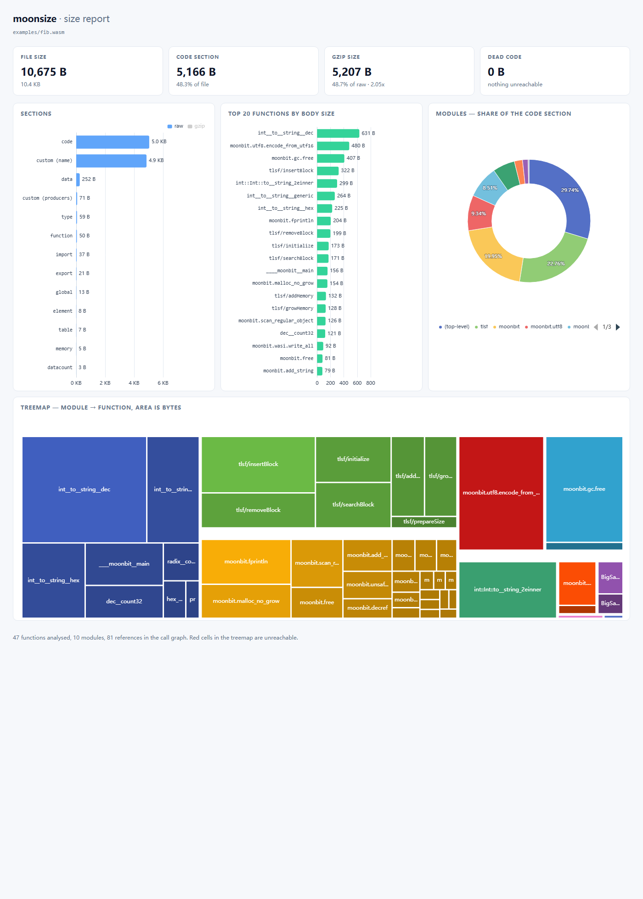

# moonsize

```sh
moon add BigSaltyMan/moonsize
```

面向 MoonBit 产物的 WebAssembly 体积分析器。读取 `.wasm` 文件，测量每个段，把 code 段归因到具体函数，跟随调用图，并报告哪些部分可以删除。

分析模型参考 [Twiggy](https://github.com/rustwasm/twiggy)：体积归因到单个函数，函数按包聚合，从模块根出发的可达性决定哪些是真正被用到的。

英文版见 [README.md](README.md)。

## 构建

```sh
moon build --release
./_build/native/release/build/cmd/main/main.exe app.wasm
```

本模块声明的是 `supported_targets = "+native"`，所以依赖它的项目也要用 `--target native` 构建。

## 用法

```
moonsize <file.wasm> [--top <n>] [--retained] [--dead-code]
                 [--compress] [--strict] [--call-graph <path>] [--html <path>]
                 [--max-size <size>] [--baseline <path.wasm>]

  --top <n>            排名显示多少个函数（默认 10）
  --retained           删除每个函数能连带释放多少
  --dead-code          从根不可达的函数
  --compress           文件和每个段 gzip 压缩后要花多少字节
  --strict             调用图不完整时拒绝输出报告，而不是带着警告输出
  --call-graph <path>  把调用图写成 .dot 或 .json
  --html <path>        把图表写成自包含的 HTML 报告
  --max-size <size>    超过这个大小就以退出码 3 失败，size 可以是字节数或
                       10KB、1.5MB 这种带 KB/MB/GB 后缀的写法
  --baseline <path>    与另一个模块对比并打印变化；此时 --max-size 限制的是
                       增量，而不是文件本身

退出码：0 正常，1 输入无法读取，2 命令行错误，3 超出预算。
```

不带参数时打印段表、最重的函数和按包聚合的结果。`--retained` 和 `--dead-code` 追加各自的章节，可以组合使用。`--call-graph` 和 `--html` 写文件而不是打印报告，因此单独使用：

```sh
moonsize app.wasm --retained --dead-code        # 完整文本报告
moonsize app.wasm --html report.html            # 图表，浏览器打开
moonsize app.wasm --call-graph graph.dot        # 给 Graphviz
```

## 作为库使用

解析、分析和每一份报告都是这个模块里的普通包，所以程序可以直接取数字而不是取文本。`moon add BigSaltyMan/moonsize` 之后导入即可；入口是 `Options::default`，因为 `Options` 是只读类型，别的包无法用字面量构造它。

```moonbit
fn main {
  let bytes : Bytes = read("app.wasm")
  match @moonsize.parse_module(bytes) {
    Ok(parsed) =>
      match @moonsize.analyze(bytes, parsed) {
        Ok(analysis) => {
          let options = @moonsize.Options::default("app.wasm")
          // 最重的 5 个函数：要文本就用 render_*，要数字就读
          // `analysis.stats` 与 `analysis.retained`。
          println(@moonsize.render_top_functions(analysis.stats, analysis.data.length(), 5))
          println(@moonsize.render_graph_warning(analysis.graph))
          println(@moonsize.render_dead_code(analysis, 5))
          println(@moonsize.render_retained(analysis, 5))
          println(@moonsize.render_html(analysis, options.path))
        }
        Err(error) => println(@moonsize.describe_error(error))
      }
    Err(error) => println(@moonsize.describe_error(error))
  }
}
```

库不做任何 I/O，读文件和决定退出码都留给调用方。`supported_targets = "+native"` 同样约束依赖它的程序：用 `--target native` 构建。

## 分析原理

下面所有内容都建立在一个判断上：一个函数的字节，只有在有东西能调用它时才有意义。

### 符号名

一切归因都从二进制 name 段里的名字开始。MoonBit 没有公开它的 mangling 规则，所以这里的规则是从真实构建的 name 段里反读出来的（`moonc` 0.1.20260920，`wasm` 后端）：

- 符号形如 `_M0<kind>` 再接一条路径：`F` 普通函数，`M` 方法，`I` trait 实现；
- 包标记是 `B`（builtin 包）、`C`（`moonbitlang/core`）或 `P` 加一个索引——索引数字会和第一个组件的长度连在一起，所以 `P55probe` 是索引 `5` 接着 `5probe`；
- 组件是「长度 + 名字」，且长度数的是 **mangled 之后** 的名字；
- 不能出现在标识符里的字符用 `_` 加该字节的十六进制转义，字面下划线则写成双下划线：`to__string_2einner` 是 `to_string.inner`，`_24default__impl` 是 `$default_impl`；非 ASCII 字符按 UTF-8 逐字节转义，`中` 就是 `_e4_b8_ad`；
- 泛型实例带 `G...E`，每个实参一个编码：内置类型是单个字母，元组是 `U...E`，具名类型是 `R` 加一条路径；
- 闭包要么是名为 `__moonbit_<fn>` 的环境，要么函数体带 `C<id>l<line>`（闭包 id 与它所在的源码行号）；
- trait 实现会写出两个包：类型所在的包和 trait 所在的包。

报告里打印的是 `display_name` 解出的路径。`demangle_full` 是更完整的解码器，供需要「转义还原 + 实参展开 + 闭包标记」的调用方使用。两者都只是展示工具而非编解码器：解不出来的符号原样返回——编出一个名字比显示原始符号更糟。已知的边界就是会原样返回的情况：类型编码不是构建实际产出过的字母（`Int`、`Double`、`String`、`Bool`、`Char`、`Byte`、`Float`、`Int64`、`UInt64`、`Unit`）时，实参不做猜测；具名实参只有在列表最后一位时才解码，因为它的路径没有终止符，无法与后面的内容区分；超过 4096 字节的符号直接拒绝，避免伪造的名字把回溯拖进深递归。

### 调用图

解码器逐条指令遍历每个函数体——完整的 MVP 指令集、`0xFC` 的饱和转换与批量内存操作码、MoonBit 会发出的异常处理与尾调用操作码，以及其 `wasm-gc` 后端使用的 `0xFB` 垃圾回收操作码。每个函数体贡献：

- `call x`、`return_call x` —— 指向 `x` 的精确边；
- `ref.func x` —— 一次引用，算作可达，因为该函数之后可能作为闭包被运行；
- `call_indirect`、`return_call_indirect` —— 根据静态候选，向 element 段放进该 table 的**每个**函数建立保守边。table 的内容静态不可知，而漏一条边就等于漏一个函数、把一个还在用的函数报成死代码。
- `call_ref`、`return_call_ref` —— 识别调用点，记录 `UnmodeledReferenceCall` 诊断。本版本尚未求解目标函数，即使前面紧邻 `ref.func` 也不猜测目标。

静态候选有其局限。模块可以在运行时填充 table——`table.set`、`table.init`，或者由宿主塞进去——而**完全没有 element 段**的 table 就等于什么也没说。无候选的间接调用（包括间接尾调用）贡献不了任何边，会产生不完整诊断；死代码和 retained size 结果可能不准确。报告会在最前面说明这一点：

```
WARNING: the call graph has 1 analysis gap.
  function 0, offset 42: call_ref: reference-call target analysis is not implemented.

Dead-code and retained-size results may be inaccurate; do not use them as proof that a function can be removed.
```

`--dead-code` 和 `--retained` 会在各自标题下重复不完整提示；`--strict` 对这些已识别的不完整情况拒绝输出报告，返回退出码 `3`。

`call_ref` 和 `return_call_ref` 会令图不完整，即使所有表调用都有候选。`analyze` 仍返回 `Ok(Analysis)`：建模缺口与二进制解析错误不同。诊断保留类别、完整 caller 索引、文件字节偏移、真实 opcode、类型索引和可选表索引。

`graph_complete` 表示本期检测范围内未发现缺口，即 `analysis.graph.diagnostics` 为空。动态 table 写入、宿主提供的表内容及所有 Wasm 调用机制仍未完整建模，不能将 strict 成功解释为完整性认证。

如果外部世界能到达一个函数，它就是**根**：它被导出、它是 start 函数，或者被 element 段引用。可达性与 retained size 描述的是当前调用图模型中的路径。

### 解析边界与 Reader API

`Reader::read_u32_leb()` 改为返回 `Result[UInt, WasmError]`，保留 `0..4294967295` 的完整无符号范围。五字节限制内的合法非最短编码仍可使用；第五字节非法高位或 continuation bit 会返回 `LebOverflow(offset)`。长度、计数、索引和整数指令操作数统一经内部入口检查，目前支持 `0..2147483647`。更大的合法 u32 编码返回 `ValueOutOfRange(offset, value)`，表示实现范围限制，不是将这种无符号编码判为非法 Wasm。

`Reader::new(data)` 仍覆盖全文件。新增 `Reader::new_range(data, start, length) -> Result[Reader, WasmError]`，读取范围为 `[start, start + length)`；负数或文件外范围返回 `InvalidReadRange(offset, length, start, end)`。`seek(offset)` 现在返回 `Result[Unit, WasmError]`，调用方迁移时必须处理错误。允许定位到末尾，之后读取返回 `UnexpectedEnd`；失败的 seek 和 `read_bytes` 不改变游标。所有错误位置均为文件绝对偏移。

段 payload、函数体、locals、指令立即数和 name 子段分别受真实边界约束。custom 段外层名称属于结构，长度必须落在 payload 内；可选 name 调试信息保留容错，损坏条目不能借用后续字节，也不抹掉先前成功读取的名称。解析失败和范围错误的 CLI 退出码为 `1`，加 `--strict` 仍为 `1`，不会生成或覆盖 JSON、DOT、HTML 报告；它们与退出码为 `3` 的调用图缺口不同。

`parse_module` 仅接受 Core Wasm 二进制版本 `1`，检查标准段唯一性和顺序。custom 段可以同名重复，也可插在不同标准段之间。顺序采用显式规则：Type、Import、Function、Table、Memory、Tag、Global、Export、Start、Element、DataCount、Code、Data，不能按 section id 大小排序。

function 段的本地声明数必须等于 code 段函数体数，导入函数不参与比较，缺失段按零项处理。两段 payload 都必须完整消费，每个函数体的长度也必须落在 code payload 内。当前输入和 `--baseline` 在输出报告前执行相同检查；`analyze(data, parsed)` 同样重新校验实际字节并据此读取段表，旧的或被修改的段表不能绕过检查。

本工具执行体积分析所需的基础结构检查，尚未提供完整的 WebAssembly 类型和指令语义验证。类型和调用索引合法性、signed LEB 完整数值语义、64 位常量存储及动态 table 分析仍有限制。

解析函数签名保持不变。外部穷举匹配 `WasmError` 时，需要处理以下五个新增分支：

| 分支 | 字段顺序 |
|---|---|
| `UnsupportedVersion` | 版本字段偏移、原始无符号 `UInt` 版本值 |
| `DuplicateSection` | 第二次出现的段 id 字节偏移、段种类 |
| `InvalidSectionOrder` | 当前段 id 字节偏移、当前段种类、前一标准段种类 |
| `FunctionCodeCountMismatch` | 相关段 id 字节偏移、段种类、本地声明数、函数体数 |
| `TrailingSectionBytes` | 第一个未消费 payload 字节偏移、段种类 |

版本错误位于偏移 `4`；数量不一致优先指向 code 段，缺失时指向 function 段。这些错误返回输入错误码 `1`，加 `--strict` 仍为 `1`，不会变成图不完整的退出码 `3`。

### 诊断 API 与导出迁移

这是有意的 API 扩展。`CallGraph` 新增 `diagnostics : Array[GraphDiagnostic]`，`GraphDiagnosticKind` 分为 `NoStaticTableTargets` 与 `UnmodeledReferenceCall`。总缺口数从该数组读取；`Analysis.unresolved_count` 仍只统计没有静态候选的表调用，因此引用调用存在时它仍可能是零。

`scan_calls` 为 `call_ref`、`return_call_ref` 返回 `CallKind::Reference`，携带 `type_index = Some(type)` 和原始偏移。外部代码穷举匹配 `CallKind` 时必须处理新增分支。`ref.func` 仍只建立引用边，不进入调用列表。

报告接口改为 `render_graph_warning(analysis.graph)`、`render_dead_code(analysis, top)`、`render_retained(analysis, top)`。后两者内部读取诊断，移除原先分开的数组、文件大小及可选 `unresolved` 参数；上方示例与 `_probe/` 已同步更新。

JSON 保留 `module`、`functions`、`roots`、`edges`、`indirect_sites`，新增 `schema_version: 1`、`graph_complete`、`modeling_scope`、`diagnostics`。每条诊断包含 `code`、`caller`、`offset`、`opcode`、`type_index`、`table_index`，引用调用的表索引为 null。稳定代码为 `no_static_table_targets`、`unmodeled_reference_call`；完整样本的诊断数组为空。诊断按 caller、offset 排序。

非严格模式生成的文件自身保留限制：JSON 含结构化诊断与建模范围，DOT 含图级警告标签，HTML 顶部展示诊断并在死代码区域保留提示。文件被单独分享后，这些信息仍在。严格模式对三种格式都在写文件前拒绝；既不生成新文件，也不修改已有文件，退出码为 `3`。

### Retained Size

`SIZE` 是函数自身的体积。`RETAINED` 是删掉它实际能释放的体积：它自己的字节加上所有随之变得不可达的函数，`DIES` 是后者的个数。

这个集合恰好是被删函数所**支配**的函数集合——从根出发的每一条路径都必须经过的那些。把模块的图取出，在真实根之上加一个虚拟根，求支配树，一次就能得到所有函数的 retained size。环由不动点自然收敛，不需要特判；结果是精确的，而不是靠局部前驱数量做的近似：如果两条分支都调用某个函数，删掉其中一条分支不会释放它，但删掉两条分支汇合的那个点会。

怎么读这张表：

- `RETAINED == SIZE` —— 这个函数只对自己负责，删掉它只省下它自己的字节。
- `RETAINED ≫ SIZE` 且 `DIES` 较大 —— 好的候选。删掉它会带走一整棵子树。
- `IND` —— 该函数属于普通或尾部间接调用的候选；考虑删除前还需检查依赖它的 table 槽位和调用点。

两个数都打印是有意的。`SIZE` 说明编译期把函数改小能省多少；`RETAINED` 说明直接删掉它省多少，后者通常是更便宜的改动。

### 死代码

从根不可达的一切都不会运行：没有导出能到达它，没有 start 函数，没有 table 槽位，也没有从上述任何一处出发的调用链。它的字节已经付出代价却从未被使用，所以这份清单就是一份删除清单。

MoonBit 编译器的死代码消除做得很好，因此小程序通常报告为零——这本身也是一个结论。

### 压缩后体积

WebAssembly 模块不会以原始形式传输，服务端发的是 gzip 之后的内容，而省下多少完全取决于字节长什么样：机器码压不太动，符号名和字符串压得很狠，已经打包好的数据几乎不动。所以只看原始段表会在两个方向上误导人，`--compress` 回答的是网络真正关心的问题：

```
COMPRESSED SIZE
  raw   10675 B
  gzip   5207 B  (48.7% of raw, ratio 2.05x)

  BY SECTION

  SECTION              RAW  GZIP  RATIO  SHARE(GZIP)
  code                5166  2712  1.90x        52.0%
  custom (name)       4975  1983  2.50x        38.0%
  data                 252   174  1.44x         3.3%
  custom (producers)    71    95  0.74x         1.8%
  type                  59    66  0.89x         1.2%
  function              50    63  0.79x         1.2%
  import                37    61  0.60x         1.1%
  export                21    45  0.46x         0.8%
  global                13    34  0.38x         0.6%
  element                8    32  0.25x         0.6%
  table                  7    31  0.22x         0.5%
  memory                 5    29  0.17x         0.5%
  datacount              3    27  0.11x         0.5%
```

`SHARE(GZIP)` 是段压缩后大小占**整个文件压缩后**大小的比例，而不是占原始大小的比例——这一列才是要看的。这里 code 段原始占文件的 48.3%，压缩后涨到 52.0%；name 段则相反，原始 46.6%，压缩后只剩 38.0%。真正值得下手的是编译器吐出来的字节；符号名在网络上几乎是免费的，这件事最好在花一下午搞 `--strip` 之前就知道。

读这张表有两点要留意。它是估算：压缩器跑在默认等级（也就是服务端常用的等级），但服务端配置未必相同，而且它是把整个响应当一个流压，而不是每段独立压。另外每段都是独立的流，各自要付大约二十字节的 gzip 容器开销——对上千字节的段可以忽略，对只有几个字节的段就是主要成本，这也是表里最小的那些段"压完反而变大"的原因。占比几乎不受影响，因为二十字节放在上千字节的表里不算什么。

压缩器拒绝某一段时，报告写的是失败，而不是它的原始大小：文本报告里是 `gzip failed: ...`，HTML 卡片里是 `N/A`（悬停显示原因）。打印原始大小会被读成压缩率 1.00x，而那是与「根本没测到」完全不同的说法。

### 判断哪些可以删

1. 先检查诊断和建模范围，再看 `--dead-code`。列表表示当前模型中不可达的函数；图不完整时，不能把它作为可以删除函数的证明。
2. 再看 `--retained` 中 `RETAINED` 很大且 `DIES` 大于零的行。这些是删除后会连锁的函数。
3. 对带 `IND` 的行，继续核对 table 槽位、调用点和宿主行为，再决定如何修改。

## 输出示例

一个 10,675 字节的 MoonBit 程序（`--target wasm`，debug），只保留分析章节：

```
Retained size

    #  INDEX  SIZE  RETAINED  DIES    SHARE  IND  FUNCTION
    1     47   158      5162    46    48.3%       ____moonbit__main
    2     39   301      1773    10    16.6%       int::Int::to__string_2einner
    3     37    24       887     8     8.3%       println
    4     34     9       819     5     7.6%       moonbit.println
    5     33   206       810     4     7.5%       moonbit.fprintln
    6     28    49       717     7     6.7%       moonbit.decref
    7     29   409       668     6     6.2%       moonbit.gc.free
    8     43   633       633     0     5.9%       int__to__string__dec

  DIES counts the other functions that become unreachable with this one.
  IND marks a function an indirect call could reach.

Dead code

  0 of 47 functions are unreachable from the roots
  0 bytes (0.0% of file)

  every function is reachable
```

`____moonbit__main` retained 5,162 字节——占文件的 48.3%，牵连 46 个函数——这正是单入口程序的样子：所有东西都挂在它下面。`int__to__string__dec` 是最大的单个函数（633 字节），但只 retained 自己，所以要缩小它属于改代码，而不是删代码。

`--call-graph graph.dot` 把同一张图写给 Graphviz，死函数画成虚线，间接边画成点线；`--call-graph graph.json` 则输出根、每条边以及每个间接调用点的候选集。

## HTML 报告

`--html <path>` 把同一份分析写成一个自包含页面：不需要服务器、不需要构建步骤、不需要联网。打开文件就能看到四张图，其中压缩后体积是文本报告只在 `--compress` 下才给的内容。



仓库里放了一份现成的例子：[`examples/report.html`](examples/report.html)，由 [`examples/fib.wasm`](examples/fib.wasm) 生成——一个 10,675 字节的 MoonBit 程序。它只有一个文件：图表库被内联进去，所以可以随意移动、发送、在任何地方打开。它的源码是 [`examples/fib.mbt`](examples/fib.mbt)，同时也是本模块的一个包：构建 `--target wasm` 时会连同工具一起产出这个示例。

**顶部四个数字。** 文件总大小、code 段大小、gzip 之后的大小，以及文件中不可达部分的大小。gzip 那张卡片下方带着占原始大小的比例和压缩率；不可达那张在有东西可删时会变红——多数人打开报告就是为了这个数。

**Sections（段概览）** —— 每个段一条横向条形，按体积从大到小排列，悬浮提示里给出占文件的比例。这就是第一阶段的段表，画出来了。两张条形图的高度都按行数自适应，保证每一行都带标签；固定高度会让 ECharts 丢掉大部分标签，而幸存下来的那几个看起来就像是下面无标签行的分组标题——这正是"code 段被拆成三条"的错觉来源。

段概览图有两个视图，用角落里的 `raw` / `gzip` 图例切换：同一组条形，分别按压缩前和压缩后测量。两者共用一根坐标轴、位置完全重合，所以切换看到的是压缩后究竟短了多少，而不是把坐标轴重新缩放来掩盖这一点——code 段几乎不动，name 段直接少一半。两种视图下悬浮提示都会同时给出两个数字和压缩率。

**Top 20 functions by body size** —— 编译器还能压缩的部分。这里用的是 body 大小而不是编码后大小，让排名回答"代码在哪里"，而不是"长度前缀在哪里"。

**Modules（模块聚合）** —— 环形图，展示 code 段如何在各包之间划分；分母是 code 段而非整个文件，所以每一片的含义是"哪个包占用了代码"。低于 0.5% 的扇区合并为一个 `other` 扇区，悬浮时列出成员：这么窄的扇区放不下标签，单独留着只会是一道既读不了也点不中的细缝。标签画在环内，因此不会与图例碰撞。

**Treemap** —— 模块 → 函数两级，面积代表字节数。这是唯一一张一次展示整个二进制的图：面积大的格子就是值得看的函数，函数不可达时格子画成红色。面积始终按原始大小绘制——用压缩后字节画的 treemap 是另一张图，而且更没用——所以压缩后大小和压缩率放在悬浮提示里给出，而不是画进面积。

悬浮任意条形、扇区或格子都会显示精确字节数与百分比。页面里每个数字都来自文本报告所用的同一个 `Analysis`，两者不可能对不上——压缩后的数字也一样：页面用的是同一个压缩器、同一个等级。

图表库 vendored 在 [`assets/echarts.min.js`](assets/README.md)，并被内联进页面。当该文件不在工作目录旁时——比如从别处运行已安装的二进制——页面会退回到 CDN 的 `<script src>` 标签，命令也会明确提示；那种报告需要联网才能绘制。

## CI 集成

`--max-size` 把报告变成一道闸门，`--baseline` 把它变成一次对比，于是构建可以因为「变大了」而失败，而不是因为某个人得手动维护的那个数字。

```sh
moonsize app.wasm --max-size 100KB                     # 给文件一个上限
moonsize app.wasm --baseline main.wasm --max-size 5KB  # 最多增长 5 KB
```

带 baseline 时，`--max-size` 限制的是**增量**而不是文件本身：一个 PR 要回答的问题是「它多花了多少」，而不是「程序本来有多大」。带 baseline 运行时，报告之后会打印对比表，按当前分组体积从大到小排列，增量同时给出字节数和相对基线的比例：

```
SIZE COMPARISON

                      baseline  current  delta
  total                  10675    11039  +364  (+3.4%)
  code                    5166     5299  +133  (+2.5%)
  custom (name)           4975     5205  +230  (+4.6%)
  data                     252      252  0  (0.0%)
  custom (producers)        71       71  0  (0.0%)
  ...
```

标准段按段种类比较；custom 段按完整名称分组，同名段的编码大小合并为一行。名称区分大小写，保留空白，空名称有效；名为 `code` 的 custom 段不会与标准 code 段合并。比较包含各段实际编码头部和整个 payload，包括 custom 名称编码；合法非最短长度编码多占用的字节也会计入。

例如，baseline 的两个 `x` 段分别占 4 和 6 字节，current 的两个 `x` 段分别占 5 和 8 字节，只输出一行：

```text
              baseline  current  delta
  custom (x)        10       13  +3  (+30.0%)
```

这比较的是该名称下全部段的编码体积，不尝试跨构建配对同名 custom 段实例。只调整段的排列不会改变比较结果。当前总大小相同时，先按 baseline 总大小降序，再按标准段二进制顺序、custom 完整名称顺序（`String::compare`）排列；整组删除仍会显示，current 为零。

`total` 代表整个文件，包含八字节模块头；组内增减可能互相抵消。这个表用于体积分组比较，体积相同不代表内容相同。`--max-size` 配合 baseline 仍限制文件总增长，总量不变时不会因为个别分组增长而失败。

退出码：`0` 正常，`1` 输入无法读取，`2` 命令行错误，`3` 超出预算或被严格模式拒绝。

本仓库用 [`.github/workflows/ci.yml`](.github/workflows/ci.yml) 给自己上闸：格式检查、`moon check --target native --deny-warn`、`moon test`，以及把本次源码构建出的 debug Wasm 示例限制在预算内。本地 setup action 固定 MoonBit `0.10.13+cbb11c36f`，与本地格式和测试使用的版本一致，并在解析依赖前运行 `moon update`。升级工具链时应同步更新本地检查与 CI。

```yaml
- uses: ./.github/actions/setup-moonbit
- name: Build the example and CLI
  run: |
    moon build --target wasm
    moon build --target native --release
- name: The example stays inside its budget
  env:
    EXAMPLE: _build/wasm/debug/build/examples/examples.wasm
    CLI: _build/native/release/build/cmd/main/main.exe
  run: |
    test -s "$EXAMPLE"
    printf 'budget input: %s\nbytes: %s\n' "$EXAMPLE" "$(wc -c < "$EXAMPLE")"
    sha256sum "$EXAMPLE"
    "$CLI" "$EXAMPLE" --max-size 100KB
```

预算 job 直接读取上述构建产物，`examples/fib.wasm` 继续作为发布示例副本。反例使用 `0B`，显式捕获原生 CLI 状态，要求精确返回 `3` 且包含预算失败原因；文件缺失、命令无法启动或参数错误都会使任务失败。构建模式改变时，debug/release 产物路径必须同步修改。

其它产出 `.wasm` 的项目可以先用官方安装器安装兼容工具链，再执行体积预算检查：

```yaml
- name: Setup MoonBit
  run: |
    curl -fsSL https://cli.moonbitlang.com/install/unix.sh | bash -s '0.10.13+cbb11c36f'
    echo "$HOME/.moon/bin" >> "$GITHUB_PATH"
- run: moon update
- run: moon build --target wasm --release
- name: Size budget
  run: moonsize _build/wasm/release/build/app/app.wasm --max-size 250KB
```

如果要卡的是「增长」而非绝对体积，就把 base 分支也编译一份作为基线，此时 `--max-size` 的含义变成允许的增量：

```yaml
- name: Build the base branch
  run: |
    git worktree add "$RUNNER_TEMP/base" "origin/${{ github.base_ref }}"
    (cd "$RUNNER_TEMP/base" && moon build --target wasm --release)
- name: Size budget
  run: |
    moonsize _build/wasm/release/build/app/app.wasm \
      --baseline "$RUNNER_TEMP/base/_build/wasm/release/build/app/app.wasm" \
      --max-size 5KB
```

[`.github/workflows/size-check.yml`](.github/workflows/size-check.yml) 在每个 PR 上执行双边比较。两边使用同一套已安装工具链、默认 debug Wasm 模式；拷贝前检查产物存在且非空，记录来源路径、比较路径、字节数和 SHA-256。原生 CLI 最终比较临时目录中的 `$RUNNER_TEMP/current.wasm` 与 `$RUNNER_TEMP/baseline.wasm`。若历史基线没有 `examples/moon.pkg`，日志明确注明「baseline 使用仓库历史示例，未从该分支源码重新构建」；存在该包的基线必须构建成功，不能在构建失败后回退到旧二进制。

## 开发

关键决策、符号规则的已知边界、AI 工具所扮演的角色，以及所有内联资源的来源，都写在 [`docs/devlog.md`](docs/devlog.md) 里。

```sh
moon check --target native --deny-warn
moon test
moon build --target native --release
bash scripts/test-tail-calls.sh _build/native/release/build/cmd/main/main.exe
bash scripts/test-graph-diagnostics.sh _build/native/release/build/cmd/main/main.exe
bash scripts/test-parser-boundaries.sh _build/native/release/build/cmd/main/main.exe
```

诊断 CLI 脚本需要 Node.js，使用 V8 独立验证 Wasm 样本，并解析 JSON 后断言字段。解析边界脚本还用 Node.js 为每个 CLI 进程设置五秒超时，分别识别超时、崩溃和预期输入错误。三个脚本都可在 Git Bash 或 Linux 上对已构建的 native 可执行文件运行。完整模块样本与 V8 交叉验证；Reader 专用和可选调试信息测试另行标注。

测试逐条覆盖指令表——每条指令带一个规范编码和规范给出的长度——并固定了三个真实的 MoonBit 函数体，其中一个是 locals 使用两字节 GC 引用类型的，这样一旦某个立即数宽度写错，失败的是一个测试，而不是悄悄产生一张错误的调用图。

### 重新生成示例

[`examples/report.html`](examples/report.html) 和本 README 里引用的数字——文件大小、段占比、Retained Size——都是从真实构建产物里读出来的，不是手写的。所以改了 [`examples/fib.mbt`](examples/fib.mbt)，或者升级了工具链之后，它们就过期了，需要构建、复制产物，再生成报告：

```sh
moon build --target wasm

cp _build/wasm/debug/build/examples/examples.wasm \
  examples/fib.wasm

moon run cmd/main -- \
  --html examples/report.html \
  examples/fib.wasm
```

第一步构建 `examples/`，产物落在 `_build/wasm/debug/build/examples/examples.wasm`；第二步更新仓库里的 `examples/fib.wasm` 副本；第三步依据该副本生成 HTML。确认新报告后，再另行更新 1400px 宽、整页高度的截图。仅运行构建不会更新仓库示例副本或报告。

`.moonignore` 把渲染出来的页面挡在发布包之外——它占了原本 2.4 MB 模块中的 1.2 MB，而没人会为了看一张截图去 `moon add` 这个模块——源码、示例二进制和图表库都照常发布。
