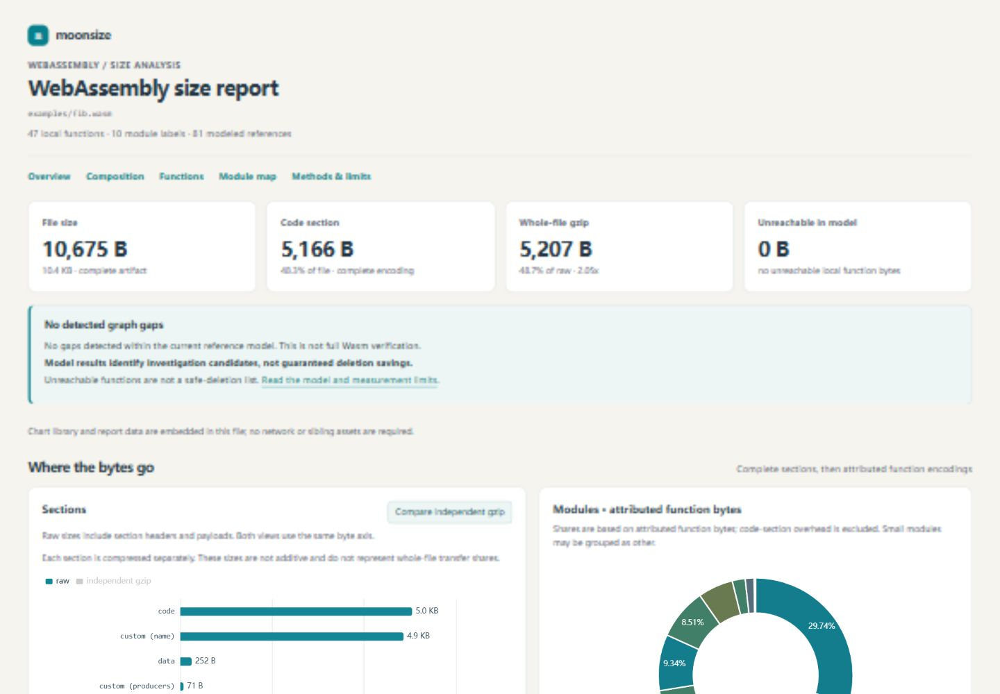
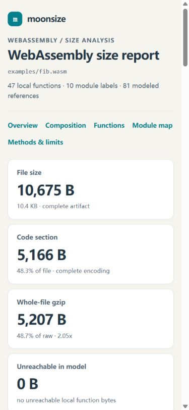

# moonsize

```sh
moon add BigSaltyMan/moonsize
```

面向 MoonBit 产物的 WebAssembly 体积分析器。读取 `.wasm` 文件，测量每个段，把 code 段归因到具体函数，并根据引用图提供需要进一步调查的优化候选，不预测删除源码后的精确减量。

分析模型参考 [Twiggy](https://github.com/rustwasm/twiggy)：体积归因到单个函数，函数按包聚合，可达性取决于当前模型的根和边。解释删除候选前，请阅读[retained size 边界与重编译实测案例](docs/retained-size-boundaries.md)。

英文版见 [README.md](README.md)。

## 构建

```sh
moon build --release
./_build/native/release/build/cmd/main/main.exe app.wasm
```

本模块声明的是 `supported_targets = "+native"`，所以依赖它的项目也要用 `--target native` 构建。

## 用法

```
moonsize <file.wasm> [--top <n>] [--retained] [--dead-code]
                 [--compress] [--strict] [--call-graph <path>] [--html <path>]
                 [--max-size <size>] [--baseline <path.wasm>] [--diff-functions]
                 [--experiment <report.html|report.json>] [--experiment-context <context.json>]

  --top <n>            排名显示多少个函数（默认 10）
  --retained           当前图模型中受支配函数的编码字节总和
  --dead-code          从根不可达的函数
  --compress           整文件 gzip 与各段独立 gzip 大小
  --strict             调用图不完整时拒绝输出报告，而不是带着警告输出
  --call-graph <path>  把调用图写成 .dot 或 .json
  --html <path>        把图表写成自包含的 HTML 报告
  --max-size <size>    超过这个大小就以退出码 3 失败，size 可以是字节数或
                       10KB、1.5MB 这种带 KB/MB/GB 后缀的写法
  --baseline <path>    与另一个模块对比并打印变化；此时 --max-size 限制的是
                       增量，而不是文件本身
  --diff-functions     追加函数与包级差异，必须配合 --baseline
  --experiment <path>  生成前后产物优化实验报告，需 --baseline，输出路径不能已存在
  --experiment-context <path>  附上声明的构建设置与业务验证记录

退出码：0 正常，1 输入无法读取，2 命令行错误，3 超出预算。
```

不带参数时打印段表、最重的函数和按包聚合的结果。`--retained` 和 `--dead-code` 追加各自的章节，可以组合使用。`--call-graph` 和 `--html` 写文件而不是打印报告，因此单独使用：

```sh
moonsize app.wasm --retained --dead-code        # 完整文本报告
moonsize app.wasm --html report.html            # 图表，浏览器打开
moonsize app.wasm --call-graph graph.dot        # 给 Graphviz
```

## 优化实验报告

```sh
moonsize after.wasm --baseline before.wasm --experiment experiment.html \
  --experiment-context context.json --top 20
```

离线 HTML 或 CI 使用的 JSON 报告汇总产物 SHA-256、实测文件与整文件 gzip 差值、段/函数/包差异、图诊断，以及声明的构建条件和业务验证记录。配置不同、验证失败和缺少记录均会显示；不会把文件变小直接判为成功优化。说明中的命令只记录，不执行；已存在的输出路径不会被覆盖。见[完整格式与复现流程](docs/optimization-experiments.md)和[报告示例](examples/optimization-experiment.html)。

## 多指标预算与 CI 摘要

用版本化 JSON 配置同时检查多个实际字节指标：

```sh
moonsize after.wasm --baseline before.wasm --budget moonsize-budget.json \
  --budget-json budget-result.json --budget-md budget-summary.md
```

版本 1 使用非空 `rules` 数组，每条规则包含唯一非空 `id`、`metric`、`mode`、
`max_bytes`。阈值使用 0 到 2147483647 的非负十进制整数，零合法；未知字段、
小数、指数和错误类型在读取 Wasm 前拒绝。支持 `file.raw`、整文件 `file.gzip`、
完整 `code.raw` 和 `package.raw`；包规则另需报告中的精确 `package` 标签。
`absolute` 判断当前字节，`growth` 判断 current − baseline 并要求 `--baseline`。
等于阈值通过，缩小保留负增量。

code 指标包含段头、长度前缀和函数数量编码。包指标沿用符号归因，累计本地函数
`total_size`（包含函数体长度前缀），不表示完整源码包成本或删除收益。缺名或
无法确认的归属使包规则 unavailable；充分归因的增长比较允许单侧标签缺失记零，
说明新出现/消失，两侧均无该标签则无法评估。文件、code 和 gzip 的成功结果仍保留。
gzip 采用当前压缩器默认配置，将完整文件压成一个流，不预测服务端编码或网络成本，
不累加独立段/函数 gzip。

每条规则分别给出 passed、exceeded 或 unavailable、数值和原因。全部通过返回
`0`；可评估且有超限返回 `3`；输入、测量、归因或输出错误返回 `1`，优先于超限；
参数和配置错误返回 `2`。strict 仍在普通报告写入前以 `3` 拒绝不完整图。
JSON/Markdown 可同时输出，包含输入哈希、覆盖率和指标边界，拒绝已有路径。
`--budget` 与 `--max-size`、路径查询、实验、HTML 和调用图输出冲突，可组合适用的
普通文本附加选项。

[配置、API 迁移及详细约定](docs/budgets.md) 与[实际演示配置](examples/budget.json)
均可复核。先运行源码演示，再对它的真实产物使用示例包标签：

```sh
node scripts/demo-budget.mjs _build/native/release/build/cmd/main/main.exe
_build/native/release/build/cmd/main/main.exe _build/budget-demo/after.wasm \
  --baseline _build/budget-demo/before.wasm --budget examples/budget.json
```

CI 保留既有回归，新增预算回归和源码/回退演示，保存 JSON/Markdown，并对本次
新构建示例应用[文件、gzip、code 配置](examples/ci-budget.json)，将实际生成的
Markdown 加入 CI step summary。

## 查询函数引入路径

从报告中找到大函数的 index 后，可以查询哪个模型入口引用了它：

```sh
moonsize app.wasm --why-index 47
moonsize app.wasm --why-index 47 --why-root 0
moonsize app.wasm --why-index 47 --why-json function-path.json --strict
```

这里的 index 仅作说明。查询返回一条边数最少、结果稳定的模型路径。根按函数
index 排序，邻接边依次按目标 index、direct/reference/indirect、指令偏移排序。
每条边保留真实 opcode（普通调用、尾调用、`ref.func` 或间接候选）和原文件指令
偏移。间接边仅表示已知候选，`ref.func` 表示取得引用，不代表执行调用；不会猜测
尚未建模的 `call_ref` 目标。找到路径时也保留全图诊断。

默认从全部现有模型根出发，保留每个 export 名称、start 和保守 element 引用的
来源。同一函数可以有多条根来源。目标自身在 element 中时，默认零步路径是如实
结果；`--why-root` 可选择一个真实模型根查看上游路径，不改变全局可达性或
retained 算法。从指定入口未找到，不代表整个模块不可达。根位置明确使用段起点
及 export/element 序号，与调用指令的精确偏移区分。

结果区分 `found`、`not-found-within-model`、`search-limited`。图不完整时，已知
路径和未找到路径都保留限制说明；未找到尤其不能作为不可达证明。导入函数的
`encoded_size` 为 `null`，因为本文件没有它的函数体。独立 JSON 格式为
`moonsize-function-path`，`schema_version` 为 `1`，包含结构化根来源、有序节点、
边、诊断、限额及计数。JSON 拒绝覆盖已有路径，strict 拒绝发生在创建报告之前。

查询模式只允许这三个查询参数及 `--strict`；其他报告、比较、实验、预算选项，
包括显式 `--top`，均在读取文件前报冲突。完成查询（找到或未找到）返回 `0`，
输入、索引、根或输出错误返回 `1`，参数错误返回 `2`，搜索受限或 strict 拒绝
不完整图返回 `3`。

库入口是 `explain_function(data, target_index, root?, limits?)`，直接从完整模块
建图，不计算支配树；配套 `render_function_path`、`render_function_path_json`
及 `describe_function_path_error`。`PathLimits::new()` 默认 100,000 节点、
1,000,000 边和 256 层。节点限额分别约束根数量和访问节点；边限额分别约束根
来源记录、索引边和检查边。准备阶段触发限额也返回搜索受限。这些查询限额不约束
二进制解析和既有建图本身的成本，排序另有成本。原有解析、分析函数签名不变；
`Options` 增加三个可选查询字段，检查 options 或穷举新增状态、错误枚举的调用方
应相应处理。

这是当前引用模型中的路径，不是实际执行轨迹，也不预测重编译或 gzip 收益。
实际优化收益应比较修改前后完整构建产物。

```sh
node scripts/test-function-path.mjs _build/native/release/build/cmd/main/main.exe
node scripts/demo-function-path.mjs _build/native/release/build/cmd/main/main.exe
```

源码演示从真实产物查找函数 index，查询导出入口经过 `path_upstream` 到
`path_target` 的路径，删除上游调用后重建并生成优化实验报告，再回退核对原始
字节和完整路径证据。保留基础输出、明确删除可选输出，不声称行为完全等价。
源码、哈希、路径、运行输出和实验报告均保存在 `_build/function-path-demo/`，
CI 上传证据；不将路径字节求和作为删除收益。

## 作为库使用

解析、分析和每一份报告都是这个模块里的普通包，所以程序可以直接取数字而不是取文本。`moon add BigSaltyMan/moonsize` 之后导入即可；入口是 `Options::default`，因为 `Options` 是只读类型，别的包无法用字面量构造它。

```moonbit
fn main {
  let bytes : Bytes = read("app.wasm")
  match @moonsize.parse_module(bytes) {
    Ok(parsed) =>
      match @moonsize.analyze(bytes, parsed) {
        Ok(analysis) => {
          let options = @moonsize.Options::default("app.wasm")
          // 最重的 5 个函数：要文本就用 render_*，要数字就读
          // `analysis.stats` 与 `analysis.retained`。
          println(@moonsize.render_top_functions(analysis.stats, analysis.data.length(), 5))
          println(@moonsize.render_graph_warning(analysis.graph))
          println(@moonsize.render_dead_code(analysis, 5))
          println(@moonsize.render_retained(analysis, 5))
          println(@moonsize.render_html(analysis, options.path))
        }
        Err(error) => println(@moonsize.describe_error(error))
      }
    Err(error) => println(@moonsize.describe_error(error))
  }
}
```

库不做任何 I/O，读文件和决定退出码都留给调用方。`supported_targets = "+native"` 同样约束依赖它的程序：用 `--target native` 构建。

## 分析原理

下面所有内容都建立在一个判断上：一个函数的字节，只有在有东西能调用它时才有意义。

### 符号名

一切归因都从二进制 name 段里的名字开始。MoonBit 没有公开它的 mangling 规则，所以这里的规则是从真实构建的 name 段里反读出来的（`moonc` 0.1.20260920，`wasm` 后端）：

- 符号形如 `_M0<kind>` 再接一条路径：`F` 普通函数，`M` 方法，`I` trait 实现；
- 包标记是 `B`（builtin 包）、`C`（`moonbitlang/core`）或 `P` 加一个索引——索引数字会和第一个组件的长度连在一起，所以 `P55probe` 是索引 `5` 接着 `5probe`；
- 组件是「长度 + 名字」，且长度数的是 **mangled 之后** 的名字；
- 不能出现在标识符里的字符用 `_` 加该字节的十六进制转义，字面下划线则写成双下划线：`to__string_2einner` 是 `to_string.inner`，`_24default__impl` 是 `$default_impl`；非 ASCII 字符按 UTF-8 逐字节转义，`中` 就是 `_e4_b8_ad`；
- 泛型实例带 `G...E`，每个实参一个编码：内置类型是单个字母，元组是 `U...E`，具名类型是 `R` 加一条路径；
- 闭包要么是名为 `__moonbit_<fn>` 的环境，要么函数体带 `C<id>l<line>`（闭包 id 与它所在的源码行号）；
- trait 实现会写出两个包：类型所在的包和 trait 所在的包。

报告里打印的是 `display_name` 解出的路径。`demangle_full` 是更完整的解码器，供需要「转义还原 + 实参展开 + 闭包标记」的调用方使用。两者都只是展示工具而非编解码器：解不出来的符号原样返回——编出一个名字比显示原始符号更糟。已知的边界就是会原样返回的情况：类型编码不是构建实际产出过的字母（`Int`、`Double`、`String`、`Bool`、`Char`、`Byte`、`Float`、`Int64`、`UInt64`、`Unit`）时，实参不做猜测；具名实参只有在列表最后一位时才解码，因为它的路径没有终止符，无法与后面的内容区分；超过 4096 字节的符号直接拒绝，避免伪造的名字把回溯拖进深递归。

### 调用图

解码器逐条指令遍历每个函数体——完整的 MVP 指令集、`0xFC` 的饱和转换与批量内存操作码、MoonBit 会发出的异常处理与尾调用操作码，以及其 `wasm-gc` 后端使用的 `0xFB` 垃圾回收操作码。每个函数体贡献：

- `call x`、`return_call x` —— 指向 `x` 的精确边；
- `ref.func x` —— 一次引用，算作可达，因为该函数之后可能作为闭包被运行；
- `call_indirect`、`return_call_indirect` —— 根据静态候选，向 element 段放进该 table 的**每个**函数建立保守边。table 的内容静态不可知，而漏一条边就等于漏一个函数、把一个还在用的函数报成死代码。
- `call_ref`、`return_call_ref` —— 识别调用点，记录 `UnmodeledReferenceCall` 诊断。本版本尚未求解目标函数，即使前面紧邻 `ref.func` 也不猜测目标。

静态 element 段提供的是**已知候选**。导入、导出、运行时写入或未建模初始化可能使候选不完整；本版本对此保守诊断，严格模式拒绝报告。普通和尾间接调用即使候选非空也会记录风险，已知候选边继续保留；没有静态候选的调用另有独立诊断。死代码和 retained size 结果可能不准确，报告会在最前面说明：

```
WARNING: the call graph has 1 analysis gap.
  function 0, offset 42: call_ref: reference-call target analysis is not implemented.

Dead-code and retained-size results may be inaccurate; do not use them as proof that a function can be removed.
```

`--dead-code` 和 `--retained` 会在各自标题下重复不完整提示；`--strict` 对这些已识别的不完整情况拒绝输出报告，返回退出码 `3`。

建图先扫描所有函数的 `table.set`、`table.init`、`table.copy`（仅目标表）、`table.grow` 和 `table.fill`，再判断间接调用。`table.get`、`table.size` 不算写入。调用之后的写入、尚不可达函数中的写入也会导致保守拒绝：当前实现没有证明它不会执行。表索引使用「导入表在前、本地表在后」的完整空间，与导入函数数量、import 条目总序号无关。显式初始化表达式被完整消费并标为未建模，不猜测其实际目标。

`call_ref` 和 `return_call_ref` 会令图不完整，即使所有表调用都有候选。`analyze` 仍返回 `Ok(Analysis)`：建模缺口与二进制解析错误不同。诊断保留类别、完整 caller 索引、文件字节偏移、真实 opcode、类型索引和可选表索引。

`graph_complete` 表示本期检测范围内未发现缺口，即 `analysis.graph.diagnostics` 为空。动态 table 写入、宿主内容和显式初始化已保守诊断，但尚未求解；所有 Wasm 调用机制仍未完整建模，不能将 strict 成功解释为完整性认证。

如果外部世界能到达一个函数，它就是**根**：它被导出、它是 start 函数，或者被 element 段引用。可达性与 retained size 描述的是当前调用图模型中的路径。

### 解析边界与 Reader API

`Reader::read_u32_leb()` 改为返回 `Result[UInt, WasmError]`，保留 `0..4294967295` 的完整无符号范围。五字节限制内的合法非最短编码仍可使用；第五字节非法高位或 continuation bit 会返回 `LebOverflow(offset)`。长度、计数、索引和整数指令操作数统一经内部入口检查，目前支持 `0..2147483647`。更大的合法 u32 编码返回 `ValueOutOfRange(offset, value)`，表示实现范围限制，不是将这种无符号编码判为非法 Wasm。

`Reader::new(data)` 仍覆盖全文件。新增 `Reader::new_range(data, start, length) -> Result[Reader, WasmError]`，读取范围为 `[start, start + length)`；负数或文件外范围返回 `InvalidReadRange(offset, length, start, end)`。`seek(offset)` 现在返回 `Result[Unit, WasmError]`，调用方迁移时必须处理错误。允许定位到末尾，之后读取返回 `UnexpectedEnd`；失败的 seek 和 `read_bytes` 不改变游标。所有错误位置均为文件绝对偏移。

段 payload、函数体、locals、指令立即数和 name 子段分别受真实边界约束。custom 段外层名称属于结构，长度必须落在 payload 内；可选 name 调试信息保留容错，损坏条目不能借用后续字节，也不抹掉先前成功读取的名称。解析失败和范围错误的 CLI 退出码为 `1`，加 `--strict` 仍为 `1`，不会生成或覆盖 JSON、DOT、HTML 报告；它们与退出码为 `3` 的调用图缺口不同。

`parse_module` 仅接受 Core Wasm 二进制版本 `1`，检查标准段唯一性和顺序。custom 段可以同名重复，也可插在不同标准段之间。顺序采用显式规则：Type、Import、Function、Table、Memory、Tag、Global、Export、Start、Element、DataCount、Code、Data，不能按 section id 大小排序。

function 段的本地声明数必须等于 code 段函数体数，导入函数不参与比较，缺失段按零项处理。两段 payload 都必须完整消费，每个函数体的长度也必须落在 code payload 内。当前输入和 `--baseline` 在输出报告前执行相同检查；`analyze(data, parsed)` 同样重新校验实际字节并据此读取段表，旧的或被修改的段表不能绕过检查。

本工具执行体积分析所需的基础结构检查，尚未提供完整的 WebAssembly 类型和指令语义验证。类型和调用索引合法性、signed LEB 完整数值语义、64 位常量存储及动态 table 分析仍有限制。

解析函数签名保持不变。外部穷举匹配 `WasmError` 时，需要处理以下五个新增分支：

| 分支 | 字段顺序 |
|---|---|
| `UnsupportedVersion` | 版本字段偏移、原始无符号 `UInt` 版本值 |
| `DuplicateSection` | 第二次出现的段 id 字节偏移、段种类 |
| `InvalidSectionOrder` | 当前段 id 字节偏移、当前段种类、前一标准段种类 |
| `FunctionCodeCountMismatch` | 相关段 id 字节偏移、段种类、本地声明数、函数体数 |
| `TrailingSectionBytes` | 第一个未消费 payload 字节偏移、段种类 |

版本错误位于偏移 `4`；数量不一致优先指向 code 段，缺失时指向 function 段。这些错误返回输入错误码 `1`，加 `--strict` 仍为 `1`，不会变成图不完整的退出码 `3`。

### 诊断 API 与导出迁移

公开 `build(data, bodies, elements)` 改为 `build(data)`，传入完整模块字节，由入口统一解析函数体、element 和表上下文，不能通过省略写表函数或传空上下文绕过诊断。`analyze(data, parsed)` 签名保持不变，使用同一套内部规则；`count_imported_functions` 仍只统计函数导入。

`CallGraph.diagnostics` 的条目数是**原因数量**，不是调用点数量；同一调用点可以有多种原因、多个写入来源。一个表的多个导出别名合并成一条宿主暴露原因；运行时来源按文件指令偏移去重。`Analysis.unresolved_count` 保持原义，只统计没有静态候选的表调用，其他原因导致图不完整时它仍可为零。

外部穷举匹配 `GraphDiagnosticKind` 时需要处理新增分支：

| 分支 | 稳定 JSON 代码 |
|---|---|
| `NoStaticTableTargets` | `no_static_table_targets` |
| `UnmodeledReferenceCall` | `unmodeled_reference_call` |
| `ImportedTableContents` | `imported_table_contents` |
| `ExportedTableContents` | `exported_table_contents` |
| `RuntimeTableMutation` | `runtime_table_mutation` |
| `UnmodeledTableInitializer` | `unmodeled_table_initializer` |
| `UnknownTableContents` | `unknown_table_contents` |

最后一项表示目标表缺失于解析上下文，不表示已完成索引和类型验证。`GraphDiagnostic.source : GraphDiagnosticSource?` 将风险来源与调用点自身的 caller、offset、opcode 分开保存。运行时来源含完整函数索引、指令偏移和 opcode；导入/导出来源指向描述符 kind 字节，初始化来源指向表达式起点，后两类的 caller/opcode 为空。无法安全读取或不支持的表编码返回 `InvalidTableEncoding(offset, reason)`，CLI 返回输入错误 `1`；建模缺口仍返回 `Ok(Analysis)`，严格模式拒绝码为 `3`。表元数据支持多字节 reference type 和 i32 limits，table64/shared limits 明确拒绝，避免静默误读。外部穷举匹配 `WasmError` 时也须增加 `InvalidTableEncoding` 分支。

`scan_calls` 为 `call_ref`、`return_call_ref` 返回 `CallKind::Reference`，携带 `type_index = Some(type)` 和原始偏移。外部代码穷举匹配 `CallKind` 时必须处理新增分支。`ref.func` 仍只建立引用边，不进入调用列表。

报告接口改为 `render_graph_warning(analysis.graph)`、`render_dead_code(analysis, top)`、`render_retained(analysis, top)`。后两者内部读取诊断，移除原先分开的数组、文件大小及可选 `unresolved` 参数；上方示例与 `_probe/` 已同步更新。

JSON 保留 `module`、`functions`、`roots`、`edges`、`indirect_sites` 和 `schema_version: 1`、`graph_complete`、`modeling_scope`、`diagnostics`。每条诊断包含 `code`、`caller`、`offset`、`opcode`、`type_index`、`table_index`，引用调用的表索引为 null。带来源的原因额外包含 `source: {caller, offset, opcode}`，元数据来源的 caller/opcode 为 null；旧的空候选/引用诊断保留原有字段形状。完整样本的诊断数组为空，按 caller、调用偏移、稳定原因代码、来源偏移排序。JSON 和 HTML 在版本 `1` 下增补这些原因和来源字段。

非严格模式生成的文件自身保留限制：JSON 含结构化诊断与建模范围，DOT 含图级警告标签，HTML 顶部展示诊断并在死代码区域保留提示。文件被单独分享后，这些信息仍在。严格模式对三种格式都在写文件前拒绝；既不生成新文件，也不修改已有文件，退出码为 `3`。

### Retained Size

`SIZE` 是本地定义函数的编码体积，包含函数体长度前缀。`RETAINED` 是当前图与根集合下，该函数支配的所有可达本地函数的编码体积之和，包含自身；`DIES` 统计其中其它函数的数量。

支配关系回答固定图中的路径问题：从根到被支配函数的所有路径都经过所选函数。该计算不模拟修改调用者、重新编译、索引重编码，以及数据和元数据的删减。element 引用的函数会保守地作为根，包括私有表、passive 和 declarative 段。因此，诊断为空或 `--strict` 通过，也不能将 retained size 解释为精确删除收益。

怎么读这张表：

- `RETAINED == SIZE` —— 当前支配模型没有向它归因其它函数；真实源码改动仍可能影响调用者、数据和元数据。
- `RETAINED ≫ SIZE` 且 `DIES` 较大 —— 值得调查对应的依赖分支，实际收益需要修改并重编译后测量。
- `IND` —— 该函数属于普通或尾部间接调用的候选；考虑删除前还需检查依赖它的 table 槽位和调用点。

实际 Wasm 减量等于修改前文件大小减去重编译后文件大小。整文件 gzip 减量应使用相同压缩配置分别测量两个完整文件；两者都不是 retained size 或函数独立 gzip 的预测结果。定义与可复现案例见[边界说明](docs/retained-size-boundaries.md)。

### 死代码

列表表示当前根与边模型中不可达的函数。需要结合诊断、保守根策略、宿主行为和运行时契约调查，不能直接当作安全删除清单。

MoonBit 编译器的死代码消除做得很好，因此小程序通常报告为零——这本身也是一个结论。

### 压缩后体积

`--compress` 使用当前压缩器默认配置，把完整 Wasm 文件作为一个 gzip 流测量。实际服务可能使用其他 gzip 配置、其他内容编码或不压缩。各段则作为独立 gzip 流测量，用于观察局部可压缩性。

以下来自对 `examples/fib.wasm` 执行 `--compress` 的实际测量：

```
COMPRESSED SIZE
  raw   10675 B
  gzip   5207 B  (48.7% of raw, ratio 2.05x)

  BY SECTION — INDEPENDENT GZIP STREAMS

  SECTION              RAW  GZIP  RATIO
  code                5166  2712  1.90x
  custom (name)       4975  1983  2.50x
  data                 252   174  1.44x
  custom (producers)    71    95  0.74x
  type                  59    66  0.89x
  function              50    63  0.79x
  import                37    61  0.60x
  export                21    45  0.46x
  global                13    34  0.38x
  element                8    32  0.25x
  table                  7    31  0.22x
  memory                 5    29  0.17x
  datacount              3    27  0.11x

  Section gzip sizes are measured independently and are not additive.
  They do not represent shares of the whole-file gzip size.
```

段范围包含 section id、长度前缀和 payload，也包含 custom 段名称。HTML 的函数独立 gzip 使用含长度前缀的完整编码范围（`total_size`，HTML 字段 `size`），比率的 raw 分母使用同一范围，不能替换为 `bodySize`。`RATIO` 是 raw 字节数除以 gzip 字节数。小流可能因各自的头尾开销而变大，仍显示实际大小和小于 `1` 的比率。

独立流不能相加，也不能解释为整文件传输占比或删除函数可节省的字节数。整文件压缩可以利用不同范围间的重复内容；实际优化收益应比较修改前后完整构建产物的测量结果。

测量失败时，文本显示 `failed` 并列出对应段的原因；整文件 HTML 卡片失败则显示 `N/A`，悬停显示它自己的原因，其他成功测量仍保留。HTML 的 sections、functions、treemap 叶子均配对提供 `gzip` 和 `gzipError`：成功为数值与 `null`，失败为 `null` 与该项原因。该附加字段及 `compression_scope` 说明属于 HTML 内嵌数据，与调用图 JSON 导出分开。公开解析、压缩函数签名不变；`compress_sections` 对越界元数据改为返回该行的 `Err`，不再压缩空字节冒充成功。

### 判断哪些可以删

1. 先检查诊断和建模范围，再看 `--dead-code`。列表表示当前模型中不可达的函数；图不完整时，不能把它作为可以删除函数的证明。
2. 再看 `--retained` 中 `RETAINED` 很大且 `DIES` 大于零的行，调查对应的模型依赖分支；实际减量仍需重编译测量。
3. 对带 `IND` 的行，继续核对 table 槽位、调用点和宿主行为，再决定如何修改。

## 输出示例

一个 10,675 字节的 MoonBit 程序（`--target wasm`，debug），只保留分析章节：

```
Retained size

    #  INDEX  SIZE  RETAINED  DIES    SHARE  IND  FUNCTION
    1     47   158      5162    46    48.3%       ____moonbit__main
    2     39   301      1773    10    16.6%       int::Int::to__string_2einner
    3     37    24       887     8     8.3%       println
    4     34     9       819     5     7.6%       moonbit.println
    5     33   206       810     4     7.5%       moonbit.fprintln
    6     28    49       717     7     6.7%       moonbit.decref
    7     29   409       668     6     6.2%       moonbit.gc.free
    8     43   633       633     0     5.9%       int__to__string__dec

  DIES counts the other functions that become unreachable with this one.
  IND marks a function an indirect call could reach.

Dead code

  0 of 47 functions are unreachable from the roots
  0 bytes (0.0% of file)

  every function is reachable
```

这份历史示例中，`____moonbit__main` 支配的函数编码合计为 5,162 字节，包含另外 46 个函数；它是该图的主要入口。`int__to__string__dec` 自身为 633 字节，模型 retained 同为 633。两项都不是删除相应源码后的文件或 gzip 减量承诺。

`--call-graph graph.dot` 把同一张图写给 Graphviz，死函数画成虚线，间接边画成点线；`--call-graph graph.json` 则输出根、每条边以及每个间接调用点的候选集。

## HTML 报告

```sh
moonsize examples/fib.wasm --html examples/report.html
```

原分析页先显示完整输入路径、章节导航和四个精确字节数：File size、Code section、
Whole-file gzip、Unreachable in model，然后展示分析状态。图缺口及具体诊断位置
直接可见；“No detected graph gaps”只表示当前模型未检测到缺口，不是完整验证。
模型结果用于调查候选，不保证删除收益。

之后依次是段与模块构成、Top 20 函数、模块地图和可展开的方法说明。段图和函数图
分别按实际行数设置高度，不互相拉高。段图图例和可用键盘操作的比较按钮，让 raw
与 independent gzip 共用同一字节轴，小段压缩后变大仍显示实际值。独立流不能相加，
也不是整文件传输占比；测量失败保留该项自己的原因。

**无需悬停即可阅读全名。** 函数图下方的原生明细表可展开/收起，展示同一组 Top 20
本地函数的 index、完整函数名/模块、body、encoded、独立 gzip 和模型可达状态。
长名称允许折行、选择、复制，窄屏仅表格局部横向滚动。排名仍用 body 字节，独立
gzip 比率仍使用包含长度前缀的完整编码范围。index 包含前置导入编号；页面数量
明确统计本地函数。

**模块比例与颜色。** 环图分母为已归因函数编码之和，排除 code 段额外开销；tooltip
另按实际 codeSize 计算相对完整 code 段的比例。环图和模块→函数矩形树图使用相同
的模块身份颜色，不随排名换色。树图面积仍是原始函数编码字节；不可达单元格同时
使用文字和描边说明，不代表能够实际节省的体积。

native CLI 始终从可执行文件内取得固定的 ECharts 5.6.0，不再搜索当前目录或父目录
的 assets，也不下载图表库。单个 HTML 包含图表、样式、脚本和数据，不依赖远程
字体或配套文件。库接口保持兼容：render_html 未传入 echarts 源码时仍选择 CDN
模式；需要离线的库调用者应明确传入源码。图表代码缺失或受损时，明确提示失败，
卡片、函数表和方法说明仍可读。

A4 打印会按纸张宽度同步重绘图表，隐藏悬浮控件，展开必要说明，重复表头并列出
完整模块图例；打印后恢复原来的屏幕布局和展开状态。已验证迁移复制件的实际断网
渲染，并检查两份浏览器生成的 PDF，见[验收记录与复现](docs/html-delivery.md)。
生成 HTML 的生产 CLI 不需要安装 Node、浏览器或前端工具。

本次[实际生成页面](examples/report.html)沿用[仓库输入](examples/fib.wasm)，SHA-256：
`0e6f10e56434b67adb162cdb56a46553ef38b8de1abd0d0deb1fe56d7173d10c`。
文件 10,675 B、code 5,166 B、整文件 gzip 5,207 B、模型不可达本地函数编码 0 B。
[页面说明与验收边界](docs/html-report.md)记录实际 HTTP 浏览器验收、桌面/手机截图和已验证的离线、打印范围。





两张截图均来自 `http://localhost:5173/` 中实际生成的报告页面。

## CI 集成

`--max-size` 把报告变成一道闸门，`--baseline` 把它变成一次对比，于是构建可以因为「变大了」而失败，而不是因为某个人得手动维护的那个数字。

```sh
moonsize app.wasm --max-size 100KB                     # 给文件一个上限
moonsize app.wasm --baseline main.wasm --max-size 5KB  # 最多增长 5 KB
```

带 baseline 时，`--max-size` 限制的是**增量**而不是文件本身：一个 PR 要回答的问题是「它多花了多少」，而不是「程序本来有多大」。带 baseline 运行时，报告之后会打印对比表，按当前分组体积从大到小排列，增量同时给出字节数和相对基线的比例：

```
SIZE COMPARISON

                      baseline  current  delta
  total                  10675    11039  +364  (+3.4%)
  code                    5166     5299  +133  (+2.5%)
  custom (name)           4975     5205  +230  (+4.6%)
  data                     252      252  0  (0.0%)
  custom (producers)        71       71  0  (0.0%)
  ...
```

标准段按段种类比较；custom 段按完整名称分组，同名段的编码大小合并为一行。名称区分大小写，保留空白，空名称有效；名为 `code` 的 custom 段不会与标准 code 段合并。比较包含各段实际编码头部和整个 payload，包括 custom 名称编码；合法非最短长度编码多占用的字节也会计入。

例如，baseline 的两个 `x` 段分别占 4 和 6 字节，current 的两个 `x` 段分别占 5 和 8 字节，只输出一行：

```text
              baseline  current  delta
  custom (x)        10       13  +3  (+30.0%)
```

这比较的是该名称下全部段的编码体积，不尝试跨构建配对同名 custom 段实例。只调整段的排列不会改变比较结果。当前总大小相同时，先按 baseline 总大小降序，再按标准段二进制顺序、custom 完整名称顺序（`String::compare`）排列；整组删除仍会显示，current 为零。

`total` 代表整个文件，包含八字节模块头；组内增减可能互相抵消。这个表用于体积分组比较，体积相同不代表内容相同。`--max-size` 配合 baseline 仍限制文件总增长，总量不变时不会因为个别分组增长而失败。

### 函数与包级差异

```sh
moonsize current.wasm --baseline previous.wasm --diff-functions --top 20
```

新增选项追加 `FUNCTION SIZE CHANGES`、`PACKAGE SIZE CHANGES`、`MATCHING SUMMARY` 和 `CODE OVERHEAD`。不指定时，baseline 仍只输出原有文件/段比较。必须配合 `--baseline`；与 `--html`、`--call-graph` 冲突时，在读取输入前返回参数错误 `2`。其他文本选项正常组合；`--top 0` 保留汇总和匹配覆盖情况，隐藏函数与包的详细排名，正数分别限制两张排名表。

只匹配两侧本地函数中各出现一次的同一个非空原始符号，不按 index、offset、顺序、体积或显示名猜测身份。唯一符号只在一侧出现时，状态为 `added-symbol` 或 `removed-symbol`；任意一侧重名时，两侧相关记录全部为 `ambiguous`，即使另一侧没有该符号也不计为普通新增/消失。缺少或空名称为 `missing-symbol`；两类未匹配记录逐函数、逐侧保留，并统计数量及字节数。字面符号 `(unnamed)` 与无名函数不同。新增/消失符号也可能来自源码重命名或工具链变更，不能直接宣称源码函数增加/删除。无名产物仍有准确总量和包汇总，但会明确提示缺乏函数身份匹配能力。

函数比较口径是 `total_size`：函数体长度前缀、locals 和指令字节。包汇总按现有 `module_name` 尽力归因，独立纳入两侧所有函数，包括未匹配记录以及 `(unnamed)`、`(top-level)` 分组。排名先按增量绝对值降序，再按区分大小写的 UTF-16 字典序排列原始符号/包名；同一身份的最终平局按状态、两侧索引排序。索引只作定位和平局顺序，不用于匹配；不依赖 Map 遍历顺序，文本中的原始符号带引号并转义。

结果能完整对账：

```text
包编码字节总和 = 全部本地函数 total_size 总和
code 段大小 = 函数编码总量 + 段头及函数数量编码等开销
函数总增量 = 已匹配增量 + 新增符号字节 - 消失符号字节
           + 未匹配 current 字节 - 未匹配 baseline 字节
```

name、data 等其他段仍由现有段比较解释，函数增量之和不等于文件增量。`--max-size` 继续只限制文件总增长，未匹配记录不改变预算规则。当前输入的 strict 行为不变，比较本身不构建 baseline 调用图。每份文件只读一次，可能失败的比较准备在正常报告输出前完成。

库入口 `compare_modules(baseline_data, current_data)` 返回 `Result[ModuleSizeDiff, ComparisonError]`，错误区分 `Baseline(WasmError)` / `Current(WasmError)`。结果含文件大小、`baseline_code` / `current_code`（`CodeSizeSummary`：code 段大小、函数数量/编码字节和额外开销）、`functions`（`FunctionSizeChange`：状态、原始符号、可选两侧 `FunctionStat` 和增量）、`packages`（`PackageSizeChange`）及 `matching`（`MatchingSummary`：各类别数量/字节覆盖情况和已匹配增量）。`render_function_diff(diff, top)` 生成同样的文本。检查覆盖基础模块结构、函数/import 有界读取，不提供完整 Wasm 类型或指令语义验证。

API 迁移：`FunctionStat` 新增 `raw_name : String?`，在 `display_name` 前保存非空原始符号；内部构造记录时需补该字段，不能从 `name` 反推。现有显示名、包归因和大小口径不变。`Options` 新增默认 false 的 `diff_functions`；原有解析、分析、压缩和预算函数签名不变。

可选的函数名称元数据遇到非法 UTF-8 时，在该条目停止收集，保留此前名称，受损后缀按缺少符号处理，不通过有损替换制造共同身份。合法 Unicode 名称（包括字面的替换字符和 BOM）仍保留原始身份。

运行真实源码演示：

```sh
moon build --target native --release
bash scripts/demo-function-diff.sh _build/native/release/build/cmd/main/main.exe
```

脚本把 [before.mbt](examples/function-diff/before.mbt) 和 [after.mbt](examples/function-diff/after.mbt) 依次复制到同一个临时项目，以相同的 `--target wasm --debug --no-strip` 配置构建，并用 V8 确认 name 段存在；比较后回退源码，核对整个 Wasm 字节及符号差异均恢复为零。产物和实际报告保留在 `_build/function-diff-demo.*`。

本机 MoonBit `0.10.13+cbb11c36f` 实测：文件 4,977 → 10,785 字节，`classify` 编码 29 → 55 字节，新 `weighted_score` 符号 103 字节，`demo::functiondiff` 包 29 → 158 字节。包含运行时辅助函数的全部函数编码增长 2,125 字节，区别于文件增长 5,808 字节。这些是指定工具链下的演示测量，不是跨版本固定期望。

退出码：`0` 正常，`1` 输入无法读取，`2` 命令行错误，`3` 超出预算或被严格模式拒绝。

本仓库用 [`.github/workflows/ci.yml`](.github/workflows/ci.yml) 给自己上闸：格式检查、`moon check --target native --deny-warn`、`moon test`，以及把本次源码构建出的 debug Wasm 示例限制在预算内。本地 setup action 固定 MoonBit `0.10.13+cbb11c36f`，与本地格式和测试使用的版本一致，并在解析依赖前运行 `moon update`。升级工具链时应同步更新本地检查与 CI。

```yaml
- uses: ./.github/actions/setup-moonbit
- name: Build the example and CLI
  run: |
    moon build --target wasm
    moon build --target native --release
- name: The example stays inside its budget
  env:
    EXAMPLE: _build/wasm/debug/build/examples/examples.wasm
    CLI: _build/native/release/build/cmd/main/main.exe
  run: |
    test -s "$EXAMPLE"
    printf 'budget input: %s\nbytes: %s\n' "$EXAMPLE" "$(wc -c < "$EXAMPLE")"
    sha256sum "$EXAMPLE"
    "$CLI" "$EXAMPLE" --max-size 100KB
```

预算 job 直接读取上述构建产物，`examples/fib.wasm` 继续作为发布示例副本。反例使用 `0B`，显式捕获原生 CLI 状态，要求精确返回 `3` 且包含预算失败原因；文件缺失、命令无法启动或参数错误都会使任务失败。构建模式改变时，debug/release 产物路径必须同步修改。

其它产出 `.wasm` 的项目可以先用官方安装器安装兼容工具链，再执行体积预算检查：

```yaml
- name: Setup MoonBit
  run: |
    curl -fsSL https://cli.moonbitlang.com/install/unix.sh | bash -s '0.10.13+cbb11c36f'
    echo "$HOME/.moon/bin" >> "$GITHUB_PATH"
- run: moon update
- run: moon build --target wasm --release
- name: Size budget
  run: moonsize _build/wasm/release/build/app/app.wasm --max-size 250KB
```

如果要卡的是「增长」而非绝对体积，就把 base 分支也编译一份作为基线，此时 `--max-size` 的含义变成允许的增量：

```yaml
- name: Build the base branch
  run: |
    git worktree add "$RUNNER_TEMP/base" "origin/${{ github.base_ref }}"
    (cd "$RUNNER_TEMP/base" && moon build --target wasm --release)
- name: Size budget
  run: |
    moonsize _build/wasm/release/build/app/app.wasm \
      --baseline "$RUNNER_TEMP/base/_build/wasm/release/build/app/app.wasm" \
      --max-size 5KB
```

[`.github/workflows/size-check.yml`](.github/workflows/size-check.yml) 在每个 PR 上执行双边比较。两边使用同一套已安装工具链、默认 debug Wasm 模式；拷贝前检查产物存在且非空，记录来源路径、比较路径、字节数和 SHA-256。原生 CLI 最终比较临时目录中的 `$RUNNER_TEMP/current.wasm` 与 `$RUNNER_TEMP/baseline.wasm`。若历史基线没有 `examples/moon.pkg`，日志明确注明「baseline 使用仓库历史示例，未从该分支源码重新构建」；存在该包的基线必须构建成功，不能在构建失败后回退到旧二进制。

## 开发

关键决策、符号规则的已知边界、AI 工具所扮演的角色，以及所有内联资源的来源，都写在 [`docs/devlog.md`](docs/devlog.md) 里。

```sh
moon check --target native --deny-warn
moon test
moon build --target native --release
bash scripts/test-tail-calls.sh _build/native/release/build/cmd/main/main.exe
bash scripts/test-graph-diagnostics.sh _build/native/release/build/cmd/main/main.exe
bash scripts/test-parser-boundaries.sh _build/native/release/build/cmd/main/main.exe
```

诊断 CLI 脚本需要 Node.js，使用 V8 独立验证 Wasm 样本，并解析 JSON 后断言字段。解析边界脚本还用 Node.js 为每个 CLI 进程设置五秒超时，分别识别超时、崩溃和预期输入错误。三个脚本都可在 Git Bash 或 Linux 上对已构建的 native 可执行文件运行。完整模块样本与 V8 交叉验证；Reader 专用和可选调试信息测试另行标注。

测试逐条覆盖指令表——每条指令带一个规范编码和规范给出的长度——并固定了三个真实的 MoonBit 函数体，其中一个是 locals 使用两字节 GC 引用类型的，这样一旦某个立即数宽度写错，失败的是一个测试，而不是悄悄产生一张错误的调用图。

### 重新生成示例

[`examples/report.html`](examples/report.html) 和本 README 里引用的数字——文件大小、段占比、Retained Size——都是从真实构建产物里读出来的，不是手写的。所以改了 [`examples/fib.mbt`](examples/fib.mbt)，或者升级了工具链之后，它们就过期了，需要构建、复制产物，再生成报告：

```sh
moon build --target wasm

cp _build/wasm/debug/build/examples/examples.wasm \
  examples/fib.wasm

moon run cmd/main -- \
  --html examples/report.html \
  examples/fib.wasm
```

第一步构建 `examples/`，产物落在 `_build/wasm/debug/build/examples/examples.wasm`；第二步更新仓库里的 `examples/fib.wasm` 副本；第三步依据该副本生成 HTML。在 `http://localhost:5173/` 确认新报告后，再分别使用 1440 × 1000 和 390 × 844 视口更新 `examples/report-desktop.jpg` 与 `examples/report-mobile.jpg`。仅运行构建不会更新仓库示例副本或报告。

`.moonignore` 把渲染出来的页面挡在发布包之外——它占了原本 2.4 MB 模块中的 1.2 MB，而没人会为了看一张截图去 `moon add` 这个模块——源码、示例二进制和图表库都照常发布。
